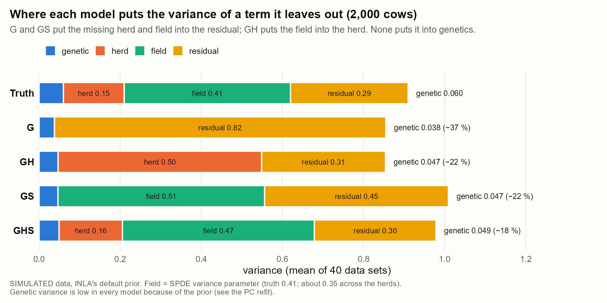

# Spatial genomic models on simulated smallholder dairy data — Step 1: one record per cow

> **All results in this repository come from SIMULATED data.** No real milk record, animal or farm location is
> included. The simulator borrows the *structure* of a real data set (herd locations, herd sizes, recording pattern);
> that input file is not shared (see [Data not included](#10-data-not-included)).

**Status (14 November 2026):** step 1 is final (85 data sets, pooled 9 November 2026). The refit of the same data
with PC priors is final (80 data sets, 10 November 2026). Steps 2 and 3 of the ladder are not in this repository.

**To replicate step 1 from the genome onwards, follow [REPRODUCE.md](REPRODUCE.md).** It covers every step (founder
genomes, population, genotypes and G, herds, spatial field, records, fits, scoring, cross-validation, pooling,
figures), with seeds and checkpoints. The founder genomes and a synthetic stand-in for the real-data backbone are
included, so the whole pipeline runs with `bash run_step1.sh`.

**Contents**
1. [Why we simulate](#1-why-we-simulate)
2. [The ladder, and why step 1 comes first](#2-the-ladder-and-why-step-1-comes-first)
3. [What is simulated](#3-what-is-simulated)
4. [Models, priors and validation](#4-models-priors-and-validation)
5. [Expected results, written before the results](#5-expected-results-written-before-the-results)
6. [Results](#6-results)
7. [What step 1 shows](#7-what-step-1-shows)
8. [What step 1 cannot tell](#8-what-step-1-cannot-tell)
9. [Repository layout and how to run](#9-repository-layout-and-how-to-run)
10. [Data not included](#10-data-not-included)
11. [Software and references](#11-software-and-references)

---

## 1. Why we simulate

Houaga et al. (2026, *Genetics Selection Evolution*) analysed test-day milk records of dairy cows on smallholder farms
in Tanzania with genomic models that add a **herd effect** and a **spatial field** (an SPDE Gaussian field in
R-INLA/inlabru). Their four models are G, GH, GS and GHS (G = genomic animal effect, H = herd, S = spatial field). The
spatial models fitted the data better and predicted hidden records better.

In real data, however, the **truth is unknown**. Nobody can check whether the estimated genetic variance is right,
whether herd and location effects are separated correctly, or whether better prediction of records means better
breeding values. A simulation can, because:

- we **choose the true values** (genetic, herd, spatial and residual variances; every cow's true breeding value);
- we build data that **look like the real data**: herd locations, herd sizes and recording pattern are resampled from
  the real data set;
- we fit **the same models with the same software and settings** (Houaga's fixed effects, mesh recipe and field prior,
  and INLA's default prior on the other variances, as in his script);
- we compare every estimate with the truth, over many replicates.

Smallholder data have features that make this check necessary:
- **most herds have one cow** (about 70 % of herds in the real data), so a herd effect and a cow's own effect are hard to
  tell apart;
- herds are spread over a large area, and **neighbouring farms share** climate, feed, markets and services: this is
  what the spatial field is meant to capture;
- cows have **few close relatives** in the data, and bulls are used across the whole area;
- the variance components are estimated in a Bayesian framework, so **the prior** can matter when the data are weak.

## 2. The ladder, and why step 1 comes first

The real situation mixes several things at once: repeated records per cow, a cow **permanent environment** (pe),
crossbreds. To see what each of them does, the study is built as a **ladder: one change per step, on the same
simulated cows** (same seeds, same founders, same bulls, same breeding values, same herds and the same spatial field).

| Step | Records per cow | True permanent environment | Models fitted | In this repository |
|---|---|---|---|---|
| **1** | **one** (one random test-day) | none | G, GH, GS, GHS | **yes** |
| 2 | about ten | none | G, GH, GS, GHS + GPHS | no |
| 3 | about ten | σ²pe = 0.04 | all eight (with and without pe) | no |

**Step 1 is the baseline.** With one record per cow nothing repeats, so there is no permanent environment and only
four kinds of variation are in play. Each is defined by **who shares it**:

| Term | Shared by | True variance |
|---|---|---|
| genetic (animal) | relatives, through the genomic relationship matrix G | 0.06 |
| herd | herd-mates | 0.15 |
| spatial field | neighbouring farms (smoothly, with distance) | 0.41 |
| residual | nobody | 0.29 |

If the models cannot separate these four with one record per cow, adding repeated records and a pe will not make the
picture clearer. And once step 1 is understood, each later step can be read as "what changes when one thing is added".

## 3. What is simulated

Script: [`scripts/questions/sb_simulate.R`](scripts/questions/sb_simulate.R).

| Piece | Setting |
|---|---|
| Breed | one population: MaCS cattle history, 1,000 founders, 2 generations of random mating |
| Genome | 29 chromosomes; 5,800 QTL (not on the chip); SNP chip of about 40,000 markers (MAF ≥ 1 %) |
| Bulls | one bull per 10 cows (100 bulls for 1,000 cows), used unevenly (log-normal popularity), **not genotyped**; on average 10 daughters per bull |
| Cows | N daughters, one per random dam, **all genotyped**; G* = 0.99 G + 0.01 I (VanRaden G), as in Houaga et al. |
| Herds | a chosen share of herds has **one cow**; the other herds take sizes from the real multi-cow herds (mostly 2–3 cows, mean 2.3) |
| Herd locations | resampled real herd locations, each moved by a random 1 km jitter |
| Records | each cow takes the recording pattern of a random real cow (calendar month, calving season, lactation group, age, lactation-curve covariates); **step 1 keeps one random test-day of it** |
| Fixed effects | true sizes from the real data, without the breed-class part (one breed) |
| Spatial field | Matérn (ν = 1) Gaussian field, range 33 km, drawn on a mesh of the real herd locations; the same field for every cell of a replicate |
| Bulls and environment | cows are assigned to herds **at random**: no link between genetics and environment |

**True values (step 1):**

| σ²g | σ²pe | σ²h | σ²s (SPDE parameter) | Range | σ²e | h² |
|---|---|---|---|---|---|---|
| **0.06** | 0 | 0.15 | 0.41 (about 0.35 across the herds) | 33 km | 0.29 | **0.066** |

The values are calibrated to the variance components estimated on the real data. Heritability is low, as in the
real data.

**Design:** number of cows × share of single-cow herds. Replicate *r* uses the same founders and the same field in every
cell, so cells differ only in the design factor.

| Cell | Cows | Single-cow herds (of herds) | Herds (realised mean) | Cows in single-cow herds | Replicates |
|---|---|---|---|---|---|
| n1000_p50 | 1,000 | 50 % | 600 | 29.8 % | 10 |
| n1000_p60 | 1,000 | 60 % | 649 | 38.6 % | 10 |
| n1000_p70 | 1,000 | 70 % | 713 | 49.7 % | 10 |
| n1000_p80 | 1,000 | 80 % | 788 | 62.9 % | 10 |
| n2000_p50 | 2,000 | 50 % | 1,210 | 30.2 % | 10 |
| n2000_p60 | 2,000 | 60 % | 1,312 | 39.4 % | 10 |
| n2000_p70 | 2,000 | 70 % | 1,436 | 50.2 % | 10 |
| n2000_p80 | 2,000 | 80 % | 1,581 | 63.2 % | 10 |
| n4000_p70 | 4,000 | 70 % | 2,874 | 50.3 % | 5 |
| **Total** | | | | | **85 data sets** |

2,000 cows at 70 % is the closest to the real data set (about 1,900 cows).

**The population in detail:** [docs/POPULATION.md](docs/POPULATION.md) covers the generations, the bulls and their
daughters, the dams, how related the cows are, the herds, the map and the spatial field, and how many half-sisters live
close to each cow.

## 4. Models, priors and validation

**Models** (script [`scripts/questions/q_fit.R`](scripts/questions/q_fit.R)). All have the same fixed effects as Houaga
et al., without the breed class: test year-month, calving year-season, age and the lactation curve within lactation
group (`tyrmn + cyrsn + ageZ:lacgr + leg1:lacgr + leg2:lacgr`).

| Model | Random terms | Role in step 1 |
|---|---|---|
| G | animal | leaves out herd and field |
| GH | animal + herd | leaves out the field |
| GS | animal + field | leaves out the herd |
| **GHS** | animal + herd + field | **the true model** |

G, GH and GS each leave out a true term on purpose: they show **where the variance of a missing term goes**.

**Priors.** A Bayesian model needs a prior for every variance. With informative data the prior hardly matters; with weak
data it can decide the answer. Step 1 was fitted twice, on identical data sets.

- **INLA's default prior** (`--priors isidore` in the code; the flag is named after the script of Houaga et al., which
  sets no prior and so uses INLA's default): loggamma(1, 5×10⁻⁵) on each precision, which is an inverse-gamma(1, 5×10⁻⁵)
  prior on the variance. It looks vague on the precision scale, but on the variance scale it puts **61 % of its
  probability below 0.0001** and 99.9 % below 0.06.
- **PC prior** (`--priors pc`). "PC" means **penalised complexity** (Simpson et al. 2017). Each random effect is seen
  as an extension of a simpler base model without it (variance 0); the prior penalises the distance from that base model
  at a constant rate, which gives an exponential prior on the standard deviation. It is set by one statement,
  P(σ > U) = α. Here: P(σ > 0.5) = 0.5 for the animal and herd effects and P(σ > 1) = 0.5 for the residual. It puts
  **1.4 % of its probability below a variance of 0.0001**.
- The spatial field has Houaga's PC-Matérn prior in both: P(σ_field > 0.5) = 0.5 and P(range < 50 km) = 0.8.

| Prior on a variance | Probability below 0.0001 | Probability below 0.06 (true σ²g) | Median |
|---|---|---|---|
| INLA's default, inverse-gamma(1, 0.00005) | 61 % | 99.9 % | 0.00007 |
| PC prior, P(σ > 0.5) = 0.5 | 1.4 % | 29 % | 0.25 |

**Integration:** empirical Bayes (`int.strategy = "eb"`), to make the 660 full-data fits and 800 cross-validation fits
affordable. On one data set it agreed with INLA's default integration to three decimals.

**Cross-validation** (script [`scripts/questions/q_validate.R`](scripts/questions/q_validate.R)), replicates 1–5 of
the 1,000- and 2,000-cow cells (40 data sets): the cows are split at random into 5 groups; each group's records are
hidden in turn and predicted from a fit to the other four, so every cow is predicted once, **from her relatives only**.
Test cows are also split by herd:
- **seen herd**: other cows of her herd are in the training data;
- **unseen herd**: none are, for example every single-cow herd.

**What we measure** (scripts [`q_extract.R`](scripts/questions/q_extract.R) and
[`sb_aggregate.R`](scripts/questions/sb_aggregate.R)):

| Measure | Meaning | Good value |
|---|---|---|
| σ̂²g (bias) | mean estimate over data sets; bias = estimate ÷ truth − 1 | within ±15 % of 0.060 |
| Coverage | share of data sets whose 95 % interval contains the truth | about 95 % |
| Collapsed | fits with σ̂²g < 0.001, i.e. at the bottom of the prior (about 0.0001 with INLA's default) | 0 |
| r(EBV, a) | correlation of EBVs with the **true** breeding values: the ranking | higher |
| Slope of a on EBV | the scale of the EBVs | 1 (above 1: EBVs shrunk too much, σ̂²g too low) |
| ΔWAIC | WAIC of the model minus WAIC of GHS (+ = worse) | 0 for GHS; > 10 is a clear difference |
| cor(y, ŷ) | Houaga's validation measure: hidden record against its prediction | higher, but mostly measures the environment |

## 5. Expected results, written before the results

These expectations were written on **7 November 2026, before any step-1 result**, and kept unchanged (the code
comments repeat them).

| | Expectation |
|---|---|
| **L1** | GHS, the true model, estimates σ²g without bias (mean within ±15 % of 0.06), but imprecisely. |
| **L2** | Herd and residual trade off (only multi-cow herds tell them apart), more so at 80 % single-cow herds. |
| **L3** | A model without a term misplaces it: G and GS put herd and field into σ²g; GH puts the field into the herd. |
| **L4** | Accuracy of the recorded cows' EBVs, r(EBV, a), of GHS is about 0.35–0.45. |
| **L7** | The EBVs of masked cows are far less accurate than those of training cows (guess 0.15–0.30 against 0.35–0.6); accuracy rises with the number of cows. |
| **L8** | cor(y, ŷ) rises by +0.2 to +0.4 from G to GHS, almost all of it environment. For unseen herds GH is no better than G; only the field helps. |

After the default-prior results showed collapsed fits, the **PC-prior refit** was planned and its expectations written
on **9 November 2026, before its results**:

| | Expectation |
|---|---|
| **PC1** | The collapsed fits disappear. |
| **PC2** | GHS at 1,000 cows rises from 0.035 to about 0.05–0.06. |
| **PC3** | If the prior causes the −18 % at 2,000 cows, the PC mean lands within 1 SE of 0.060. |
| **PC4** | WAIC is better with the PC prior in most fits; accuracy hardly changes. |

## 6. Results

### 6.1 Genetic variance


**Variance components with INLA's default prior** (mean over data sets; 40 data sets at 1,000 and 2,000 cows, 5 at
4,000). The first row is the truth.

| Cows | Model | σ̂²g (bias) | 95 % CI covers 0.06 | Collapsed | h² | σ̂²h | σ̂²s | Range km | σ̂²e |
|---|---|---|---|---|---|---|---|---|---|
| **Truth** | | **0.060** | 95 % | 0 | 0.066 | 0.150 | 0.41 | 33 | 0.290 |
| 1,000 | G | 0.019 (−68 %) | 20 % | 31 | 0.022 | – | – | – | 0.832 |
| 1,000 | GH | 0.032 (−47 %) | 46 % | 21 | 0.038 | 0.505 | – | – | 0.323 |
| 1,000 | GS | 0.033 (−45 %) | 56 % | 17 | 0.034 | – | 0.516 | 35.2 | 0.456 |
| 1,000 | **GHS** | **0.035 (−41 %)** | 60 % | 15 | 0.038 | 0.151 | 0.475 | 39.7 | 0.319 |
| 2,000 | G | 0.038 (−37 %) | 57 % | 15 | 0.046 | – | – | – | 0.817 |
| 2,000 | GH | 0.047 (−22 %) | 82 % | 6 | 0.056 | 0.502 | – | – | 0.305 |
| 2,000 | GS | 0.047 (−22 %) | 90 % | 1 | 0.047 | – | 0.510 | 35.9 | 0.453 |
| 2,000 | **GHS** | **0.049 (−18 %)** | 92 % | 0 | 0.051 | 0.156 | 0.473 | 40.4 | 0.300 |
| 4,000 | G | 0.054 (−11 %) | 80 % | 0 | 0.063 | – | – | – | 0.804 |
| 4,000 | GH | 0.055 (−9 %) | 80 % | 0 | 0.065 | 0.511 | – | – | 0.293 |
| 4,000 | GS | 0.058 (−4 %) | 100 % | 0 | 0.062 | – | 0.433 | 37.7 | 0.435 |
| 4,000 | **GHS** | **0.057 (−5 %)** | 100 % | 0 | 0.062 | 0.151 | 0.421 | 41.0 | 0.288 |

- **GHS is right only at 4,000 cows** (−5 %; sd over data sets 0.007). At 1,000 cows it is −41 % (sd 0.036) and at
  2,000 cows −18 % (sd 0.019).
- **At 1,000 cows the low mean comes from collapsed fits.** 15 of 40 GHS fits sit at about 0.0001 (G: 31 of 40). The 25
  GHS fits that did not collapse average 0.057, close to the truth. A collapsed fit sends the genetic variance to the
  residual (σ̂²e 0.358 against 0.296) and partly to the field.
- **At 2,000 cows nothing collapses, but the mean is 2.0 SE below the truth** (replicate means 0.034–0.079; SE of the
  mean 0.0053, from the 10 replicate means, because the four cells of a replicate share founders and field).
- Three fits returned no σ̂²g at all (GS n1000_p60 r9, GH n1000_p70 r5, GH n2000_p80 r7); they are counted as collapsed
  and left out of the means.

### 6.2 Where the variance of a missing term goes



- **G** puts herd and field into the **residual**: σ̂²e 0.82 ≈ 0.29 + 0.15 + 0.35.
- **GS** puts the herd into the **residual**: σ̂²e 0.45 ≈ 0.29 + 0.15.
- **GH** puts the field into the **herd**: σ̂²h 0.50 ≈ 0.15 + 0.35 (the part of the field that differs between herds).
- **No model puts the environment into the genetic variance.** With one record per cow a cow effect cannot hold anything
  that is not shared by relatives, and bulls are used at random in space, so relatives do not share an environment.
- **GHS gets the herd variance right** (0.151 and 0.156 against 0.150) and the field range slightly long (40 km against
  33; the posterior mean of a right-skewed parameter).

### 6.3 Accuracy and model fit

| Cows | Model | r(EBV, a) | Slope of a on EBV (median) | ΔWAIC vs GHS | Best WAIC in |
|---|---|---|---|---|---|
| **Target** | | higher | 1.00 | 0 | GHS in most |
| 1,000 | G | 0.354 | 0.70 | 684.7 | 0 of 40 |
| 1,000 | GH | 0.396 | 0.93 | 99.1 | 3 of 40 |
| 1,000 | GS | 0.430 | 0.94 | 184.8 | 0 of 40 |
| 1,000 | **GHS** | **0.440** | 0.94 | 0.0 | **37 of 40** |
| 2,000 | G | 0.383 | 0.93 | 1,372.7 | 0 of 40 |
| 2,000 | GH | 0.435 | 1.09 | 229.3 | 0 of 40 |
| 2,000 | GS | 0.472 | 1.31 | 360.1 | 0 of 40 |
| 2,000 | **GHS** | **0.484** | 1.24 | 0.0 | **40 of 40** |
| 4,000 | G | 0.410 | 1.01 | 2,794.8 | 0 of 5 |
| 4,000 | GH | 0.454 | 0.96 | 536.1 | 0 of 5 |
| 4,000 | GS | 0.487 | 1.03 | 650.7 | 0 of 5 |
| 4,000 | **GHS** | **0.498** | 1.00 | 0.0 | **5 of 5** |

- Accuracy ranks the models: G < GH < GS < GHS. **The field adds +0.04 to +0.05** over GH, and accuracy rises with the
  number of cows.
- **GHS has the best WAIC in 82 of 85 data sets.** The three exceptions are at 1,000 cows (in one of them GHS's σ̂²g had
  collapsed).
- The slope shows the scale error: at 2,000 cows GHS's σ̂²g is 18 % too low, so its EBVs are shrunk too much
  (slope 1.24). At 4,000 cows σ̂²g is right and the slope is 1.00.
- **A collapse ruins σ̂²g and h², not the ranking:** collapsed GHS fits still rank cows with r(EBV, a) 0.424, against
  0.450 in the others.

### 6.4 Cross-validation: cows predicted without their own records

Replicates 1–5, 20 data sets per row. Every cow is predicted once from a fit without her records.

| Cows | Model | r(EBV, a) masked: all | seen herds | unseen herds | r(EBV, a) training cows | cor(y, ŷ): all | seen herds | unseen herds |
|---|---|---|---|---|---|---|---|---|
| 1,000 | G | 0.198 | 0.195 | 0.198 | 0.357 | 0.280 | 0.271 | 0.284 |
| 1,000 | GH | 0.221 | 0.219 | 0.222 | 0.386 | 0.452 | 0.601 | 0.284 |
| 1,000 | GS | 0.253 | 0.243 | 0.259 | 0.427 | 0.625 | 0.639 | 0.610 |
| 1,000 | GHS | 0.249 | 0.240 | 0.257 | 0.431 | 0.638 | 0.669 | 0.605 |
| 2,000 | G | 0.233 | 0.235 | 0.229 | 0.365 | 0.291 | 0.281 | 0.301 |
| 2,000 | GH | 0.256 | 0.251 | 0.258 | 0.405 | 0.480 | 0.624 | 0.314 |
| 2,000 | GS | 0.308 | 0.305 | 0.310 | 0.451 | 0.641 | 0.639 | 0.644 |
| 2,000 | **GHS** | **0.321** | 0.319 | 0.323 | 0.459 | **0.666** | 0.687 | 0.651 |

- **A cow without a record** gets an EBV of accuracy 0.25 (1,000 cows) to 0.32 (2,000 cows) from GHS, against 0.43–0.46
  for recorded cows.
- **EBV accuracy is the same for seen and unseen herds**: the genetic part comes from relatives, who are spread over
  many herds.
- **Houaga's cor(y, ŷ) is mostly environment.** GHS reaches 0.64–0.67, but its genetic part, cor(y, fixed + EBV), is only
  0.28–0.32 in every model. A perfect genetic prediction (the true breeding value) would reach about 0.46–0.47.
- **Without a field, a new herd cannot be predicted:** for unseen herds GH gives 0.28–0.31, the same as G. With a field,
  the neighbours predict it: GS and GHS 0.61–0.65.

### 6.5 By share of single-cow herds

Each cell is 10 replicates (cross-validation rows: 5). The 4,000-cow data sets exist only at 70 % and are not repeated
here.

**Genetic variance σ̂²g (bias), INLA's default prior**

| Cows | Model | 50 % | 60 % | 70 % | 80 % |
|---|---|---|---|---|---|
| **Truth** | | **0.060** | **0.060** | **0.060** | **0.060** |
| 1,000 | G | 0.007 (−89 %) | 0.040 (−34 %) | 0.014 (−77 %) | 0.016 (−74 %) |
| 1,000 | GH | 0.021 (−66 %) | 0.052 (−13 %) | 0.030 (−50 %) | 0.025 (−58 %) |
| 1,000 | GS | 0.024 (−60 %) | 0.051 (−14 %) | 0.027 (−56 %) | 0.032 (−46 %) |
| 1,000 | GHS | 0.027 (−55 %) | 0.049 (−19 %) | 0.029 (−52 %) | 0.037 (−38 %) |
| 2,000 | G | 0.048 (−20 %) | 0.029 (−52 %) | 0.032 (−47 %) | 0.043 (−29 %) |
| 2,000 | GH | 0.051 (−15 %) | 0.043 (−29 %) | 0.046 (−23 %) | 0.048 (−21 %) |
| 2,000 | GS | 0.049 (−18 %) | 0.039 (−35 %) | 0.043 (−28 %) | 0.054 (−9 %) |
| 2,000 | GHS | 0.053 (−12 %) | 0.045 (−24 %) | 0.046 (−23 %) | 0.053 (−12 %) |

**GHS, every level of the design**

| Cows | Measure | 50 % | 60 % | 70 % | 80 % |
|---|---|---|---|---|---|
| 1,000 | Collapsed GHS fits (of 10), default prior | 5 | 4 | 4 | 2 |
| 1,000 | σ̂²g with the PC prior (truth 0.060) | 0.055 | 0.070 | 0.055 | 0.060 |
| 1,000 | σ̂²h (truth 0.150) | 0.146 | 0.157 | 0.150 | 0.149 |
| 1,000 | r(EBV, a), GHS | 0.446 | 0.430 | 0.447 | 0.437 |
| 1,000 | r(EBV, a), GH | 0.407 | 0.386 | 0.414 | 0.377 |
| 1,000 | Accuracy gain from the field, GHS − GH | +0.039 | +0.044 | +0.033 | **+0.060** |
| 1,000 | Masked r(EBV, a), GHS (CV) | 0.251 | 0.274 | 0.235 | 0.236 |
| 2,000 | Collapsed GHS fits (of 10), default prior | 0 | 0 | 0 | 0 |
| 2,000 | σ̂²g with the PC prior (truth 0.060) | 0.060 | 0.054 | 0.055 | 0.060 |
| 2,000 | σ̂²h (truth 0.150) | 0.162 | 0.150 | 0.156 | 0.157 |
| 2,000 | r(EBV, a), GHS | 0.488 | 0.485 | 0.483 | 0.480 |
| 2,000 | r(EBV, a), GH | 0.450 | 0.438 | 0.436 | 0.415 |
| 2,000 | Accuracy gain from the field, GHS − GH | +0.038 | +0.047 | +0.047 | **+0.065** |
| 2,000 | Masked r(EBV, a), GHS (CV) | 0.333 | 0.313 | 0.314 | 0.325 |
| 2,000 | cor(y, ŷ) unseen herds, GHS / GH (CV) | 0.670 / 0.323 | 0.652 / 0.309 | 0.643 / 0.315 | 0.640 / 0.309 |

- **σ̂²g shows no trend with the share of single-cow herds.** Cells move by up to ±20 % in no order: with 10 data sets
  per cell and fits that collapse at random, a cell mean is noisy.
- **GHS gets the herd variance right at every share** (0.146–0.162).
- **The field's gain is larger at 80 % single-cow herds** (+0.060 and +0.065 against +0.033 to +0.047). Paired within
  replicate, 80 % minus the mean of 50–70 % is +0.021 (SE 0.007; larger in 16 of 20 pairs). *This was noticed after the
  results, not expected beforehand.* The fewer herd-mates a cow has, the less the herd term can do, and the more the
  neighbours matter.
- Herd and residual trade off as expected (L2): the correlation of σ̂²h and σ̂²e over data sets at 2,000 cows is −0.11,
  −0.54, −0.62 and −0.70 from 50 % to 80 %; at 1,000 cows −0.12 to −0.52 in no order.

### 6.6 Refit with PC priors (the same 80 data sets)

Each cell shows **default prior → PC prior** on identical data sets (the 4,000-cow data sets, already right, were not
refitted).

| Cows | Model | σ̂²g | Collapsed | CI covers 0.06 | r(EBV, a) | σ̂²e | WAIC better with PC |
|---|---|---|---|---|---|---|---|
| **Truth** | | **0.060** | 0 | about 95 % | – | 0.290 | – |
| 1,000 | G | 0.019 → 0.068 | 31 → 0 | 20 % → 98 % | 0.354 → 0.362 | 0.832 → 0.792 | 39 of 40 |
| 1,000 | GH | 0.032 → 0.063 | 21 → 0 | 46 % → 90 % | 0.396 → 0.403 | 0.323 → 0.291 | 40 of 40 |
| 1,000 | GS | 0.033 → 0.061 | 17 → 0 | 56 % → 95 % | 0.430 → 0.436 | 0.456 → 0.436 | 40 of 40 |
| 1,000 | **GHS** | **0.035 → 0.060** | 15 → 0 | 60 % → 92 % | 0.440 → 0.446 | 0.319 → 0.293 | 40 of 40 |
| 2,000 | G | 0.038 → 0.063 | 15 → 0 | 57 % → 92 % | 0.383 → 0.389 | 0.817 → 0.795 | 38 of 40 |
| 2,000 | GH | 0.047 → 0.060 | 6 → 0 | 82 % → 90 % | 0.435 → 0.437 | 0.305 → 0.293 | 40 of 40 |
| 2,000 | GS | 0.047 → 0.057 | 1 → 0 | 90 % → 98 % | 0.472 → 0.473 | 0.453 → 0.445 | 40 of 40 |
| 2,000 | **GHS** | **0.049 → 0.057** | 0 → 0 | 92 % → 98 % | 0.484 → 0.485 | 0.300 → 0.293 | 40 of 40 |

- **All 106 collapsed fits disappear**, and WAIC is better with the PC prior in **317 of 320 fits**.
- **GHS at 1,000 cows: 0.060**, exactly the truth on average. The 15 data sets that collapsed under the default prior
  give 0.034; the other 25 give 0.076.
- **GHS at 2,000 cows: 0.049 → 0.057.** Every one of the 40 estimates goes up (mean +0.008, SE 0.0005). With the
  replicate-based SE the default prior is 2.0 SE below the truth and the PC prior 0.6 SE: inside the 1-SE rule written
  beforehand. The prior explains about three quarters of the gap; the rest is sampling noise.
- **The prior changes the scale, not the ranking:** accuracy moves by +0.001 to +0.008; GHS's slope moves towards 1
  (1.24 → 1.12 at 2,000 cows). The extra genetic variance comes out of the residual.
- **No prior is neutral when data are weak:** G at 1,000 cows, the weakest model, overshoots to 0.068 (+13 %).

### 6.7 Expected against found

| | Expected (before the results) | Found | Verdict |
|---|---|---|---|
| **L1** | GHS unbiased (±15 %), imprecise | −41 % / −18 % / −5 % at 1,000 / 2,000 / 4,000 cows with the default prior; 0 % and −4 % with the PC prior | Holds only at 4,000 cows, or with the PC prior |
| **L2** | Herd–residual trade-off, worse at 80 % | Trade-off present; stronger at 80 % only at 2,000 cows | Partly |
| **L3** | G and GS put the environment into σ²g; GH puts the field into the herd | GH: yes (0.50). G and GS put it into the **residual** | Half wrong |
| **L4** | GHS accuracy 0.35–0.45 | 0.44 / 0.48 / 0.50 | Holds, at the top end and above |
| **L7** | Masked 0.15–0.30, training 0.35–0.6, rising with N | GHS masked 0.25 → 0.32, training 0.43 → 0.46 | Holds |
| **L8** | cor(y, ŷ) +0.2 to +0.4 from G to GHS, all environment; unseen herds GH ≈ G | +0.36 to +0.38, genetic part flat (0.28–0.32); unseen GH 0.31 ≈ G 0.30 | Holds |
| **PC1** | Collapses disappear | 106 → 0 | Holds |
| **PC2** | GHS at 1,000 cows about 0.05–0.06 | 0.060 | Holds |
| **PC3** | GHS at 2,000 cows within 1 SE of 0.060 | 0.057, 0.6 SE | Holds: the prior caused the −18 % |
| **PC4** | WAIC better, accuracy unchanged | WAIC better in 317 of 320; accuracy +0.001 to +0.008 | Holds |

## 7. What step 1 shows

1. **With one record per cow the genetic variance is weakly identified, and INLA's default prior then decides the
   answer.** It collapses weak fits to about 0.0001 (15 of 40 GHS fits at 1,000 cows) and pulls moderately informative
   fits down (−18 % at 2,000 cows). With a PC prior the same data give unbiased estimates. Any analysis with few records
   per cow should use PC priors, or at least refit with a second prior and report how much the estimate moves.
2. **The model structure is not the problem in step 1.** With one record per cow no model puts the environment into
   the genetic variance; a missing herd or field goes to the residual (G, GS) or to the herd (GH). With PC priors all
   four models are within −5 % to +13 % of the true σ²g.
3. **The spatial field earns its place.** GHS has the best WAIC in 82 of 85 data sets, corrects the herd variance
   (0.15 instead of GH's 0.50), adds +0.04 to +0.05 accuracy, and predicts the records of cows in herds it has never
   seen almost as well as in seen herds (0.65 against 0.69), where GH cannot (0.31).
4. **The number of cows matters more than the share of single-cow herds** for the genetic variance: noisy at 1,000,
   modestly low at 2,000 (with the default prior), right at 4,000. The share of single-cow herds does not move σ̂²g,
   but the field helps most at 80 %.
5. **Report the accuracy of breeding values, not only cor(y, ŷ).** Houaga's validation measure is about twice the
   genetic accuracy and mostly reflects how well the environment is predicted.
6. **A collapse ruins the variance and heritability, not the ranking.** For choosing the best cows the prior hardly
   matters; for heritability, response to selection and index weights it matters a lot.

## 8. What step 1 cannot tell

- **One record per cow is not the real data**, which have about ten test-day records per cow. Repeated records and a
  permanent environment are steps 2 and 3, not in this repository; they change the picture, because a cow effect can
  then absorb a missing permanent environment.
- **Best-case world:** one breed, bulls used at random in space (no link between genetics and environment), and a field
  simulated from the same Matérn family that is fitted.
- **10 replicates per cell** (5 at 4,000 cows, which exists only at 70 %; no cross-validation at 4,000). Cell means can
  move by about ±20 % by chance; pooled rows are more reliable than single cells.
- **Empirical-Bayes integration** instead of INLA's default (checked on one data set only).
- The real genomic relationship matrix may differ from the simulated one (number of relatives, population structure).

## 9. Repository layout and how to run

```
README.md                         this file
REPRODUCE.md                      step-by-step replication, from the founder genomes to the tables, with checkpoints
run_step1.sh                      runs every step for any set of data sets on one machine (no Slurm)
docs/POPULATION.md                the simulated population: generations, families, herds, map, relatives close by
founders/                         the 10 founder-genome files of the paper (MaCS, about 2 MB each) and their MD5 sums
synthetic/backbone_synthetic.rds  synthetic stand-in for the real-data backbone (invented locations and records)
scripts/
  make_synthetic_backbone.R       builds synthetic/backbone_synthetic.rds
  questions/sb_simulate.R         simulate one data set (step 1: --records one --spe 0)
  questions/q_fit.R               fit G, GH, GS, GHS (--priors isidore = INLA's default, or --priors pc)
  questions/q_extract.R           compare the fits with the truth (bias, coverage, accuracy, slope, WAIC)
  questions/q_validate.R          5-fold cross-validation (--cv kfold)
  questions/sb_aggregate.R        pool all data sets of a study into tables
  sim/_paths.R, _mesh.R, _fit_setup.R   shared helpers (folders, Houaga's mesh recipe, data and field set-up)
  make_readme_figures.R           the two figures of this README, from results/
  describe_population.R           the numbers of docs/POPULATION.md (also rebuilds the pedigree of replicates 1-3)
cluster/
  q_task.sbatch                   Slurm array job: one task = one data set
  tasks_SB1.txt                   the 80 data sets at 1,000 and 2,000 cows
  tasks_SB1big.txt                the 5 data sets at 4,000 cows
  tasks_SB1pc.txt                 the PC-prior refit of the 80 data sets
results/
  step1_default_prior/            pooled output of sb_aggregate.R: report.md, sb_summary.csv (per cell x model),
                                  sb_by_rep.csv (per data set x model), sb_cv_by_rep.csv (cross-validation)
  step1_pc_prior/                 the same for the PC refit, plus waic_default_vs_pc.csv (WAIC per fit, both priors)
  population/                     summary tables behind docs/POPULATION.md (counts and distances, no coordinates)
figures/                          PNG figures of this README
```

Each script starts with a comment block that explains its role in step 1, why it is needed, and what was expected.
Comments further down sometimes cite project notes (`docs/...`) that are not in this repository; this README holds
their step-1 content. The scripts also serve later steps and other studies of the project, so some options are not
used in step 1; the comment blocks say which.

**One data set, by hand** (from the repository root; first put the founder files in `runs/founders/` and a backbone in
`data/backbone/backbone_tz.rds`, see [REPRODUCE.md](REPRODUCE.md), Steps 1–2; `bash run_step1.sh` then runs all the
steps below):

```bash
RUN=runs_q/SB1_one_record/n1000_p70_r01
Rscript scripts/questions/sb_simulate.R --run $RUN --rep 1 --ncow 1000 --p1 0.70 --records one --spe 0
Rscript scripts/questions/q_fit.R      --run $RUN --qmodels G,GH,GS,GHS --priors isidore
Rscript scripts/questions/q_extract.R  --run $RUN
Rscript scripts/questions/q_validate.R --run $RUN --cv kfold --qmodels G,GH,GS,GHS --priors isidore   # replicates 1-5
Rscript scripts/questions/sb_aggregate.R --question SB1_one_record      # after all data sets are done
```

**All data sets on a Slurm cluster** (edit the `cd` line of `cluster/q_task.sbatch` to your clone; create `logs/`):

```bash
# step 1, INLA's default prior: 80 data sets, cross-validation in replicates 1-5
SIMSCRIPT=scripts/questions/sb_simulate.R FITFLAGS="--priors isidore" VCV=kfold VMODELS=G,GH,GS,GHS VREPS=5 \
  sbatch --export=ALL,TASKS=cluster/tasks_SB1.txt --array=1-80%4 cluster/q_task.sbatch
# 4,000 cows: 5 data sets, no cross-validation (needs more memory and time)
SIMSCRIPT=scripts/questions/sb_simulate.R FITFLAGS="--priors isidore" \
  sbatch --export=ALL,TASKS=cluster/tasks_SB1big.txt --array=1-5%2 --mem=64G --time=7-00:00:00 cluster/q_task.sbatch
# PC-prior refit of the SAME data: copy data/ and truth/, then fit only
for d in runs_q/SB1_one_record/n1000_* runs_q/SB1_one_record/n2000_*; do
  mkdir -p runs_q/SB1_pc/$(basename $d) && cp -r $d/data $d/truth runs_q/SB1_pc/$(basename $d)/
done
SIMSCRIPT=scripts/questions/sb_simulate.R FITFLAGS="--priors pc" \
  sbatch --export=ALL,TASKS=cluster/tasks_SB1pc.txt --array=1-80%4 cluster/q_task.sbatch
Rscript scripts/questions/sb_aggregate.R --question SB1_pc
```

Set `SIMSCRIPT` as shown: the job script's default simulator belongs to another study and is not in this repository.
Seeds depend only on the replicate number (20261001 + 1000 × replicate), so a replicate gives the same founders,
bulls, cows and field in every cell. Founder genomes (MaCS) are cached in `runs/founders/` on first use.

**Cost** (median per data set, from the `minutes` columns of the results; 5 CPUs, 6 at 4,000 cows): fitting the four
models takes 8 min at 1,000 cows, 46 min at 2,000 and about 4 h at 4,000 (dense G); the 5-fold cross-validation adds
about 45 min at 1,000 cows and 4 h at 2,000.

## 10. Data not included

- **`data/backbone/backbone_tz.rds`** is built from the real field data analysed by Houaga et al. and is **not
  shared**. It is an R list with:
  - `herds`: one row per real herd; columns `herd`, `region`, `ward`, `x_km`, `y_km` (projected coordinates in km);
  - `cows`: `animal_id`, `herd`, `dgrp` (breed class);
  - `records`: one row per real test-day record; columns `animal_id`, `herd`, `tyrmn`, `cyrsn`, `dgrp`, `lacgr`,
    `ageZ`, `leg1`, `leg2`, `year`, `Xb_true` (fixed-effect part of the record, from one least-squares fit to the real
    data), `rec_id`;
  - `b`: named fixed-effect coefficients from that fit (only the breed-class terms `dgrp2`–`dgrp4` are used, to remove
    the breed part);
  - `fixed_formula`, `meta`.

  No milk record of the real data is used: the simulated phenotypes are built only from the simulated effects and the
  fixed-effect sizes.
- **A synthetic stand-in is included:** `synthetic/backbone_synthetic.rds`, made by `scripts/make_synthetic_backbone.R`.
  It has the same format, with invented herd locations and recording patterns. With it the whole pipeline runs end to
  end; the results are similar in kind but not identical to the numbers above (REPRODUCE.md, route B).
- **Per-data-set folders** (`runs_q/…`: simulated records, G and its inverse, fits) are not included: they are large and
  are rebuilt by the scripts. The pooled results in `results/` are what the README reports.

## 11. Software and references

**Software on the cluster:** R 4.5; R-INLA 26.8.7; inlabru 2.15.0; fmesher 0.8.0; AlphaSimR (development version,
commit a3d58f40); dqrng 0.4.1; ggplot2 and ragg for the figures.

**References**
- Houaga I. et al. (2026). *Genetics Selection Evolution* — genomic and spatial models for smallholder dairy data in
  Tanzania; the models, fixed effects, mesh recipe and field prior used here follow this paper.
- Simpson D., Rue H., Riebler A., Martins T. G., Sørbye S. H. (2017). Penalising model component complexity: a
  principled, practical approach to constructing priors. *Statistical Science* 32: 1–28.
- Lindgren F., Rue H., Lindström J. (2011). An explicit link between Gaussian fields and Gaussian Markov random fields:
  the stochastic partial differential equation approach. *Journal of the Royal Statistical Society B* 73: 423–498.
- Bachl F. E., Lindgren F., Borchers D. L., Illian J. B. (2019). inlabru: an R package for Bayesian spatial modelling
  from ecological survey data. *Methods in Ecology and Evolution* 10: 760–766.
- Gaynor R. C., Gorjanc G., Hickey J. M. (2021). AlphaSimR: an R package for breeding program simulations.
  *G3 Genes|Genomes|Genetics* 11: jkaa017.
- Chen G. K., Marjoram P., Wall J. D. (2009). Fast and flexible simulation of DNA sequence data. *Genome Research*
  19: 136–142.
- VanRaden P. M. (2008). Efficient methods to compute genomic predictions. *Journal of Dairy Science* 91: 4414–4423.
