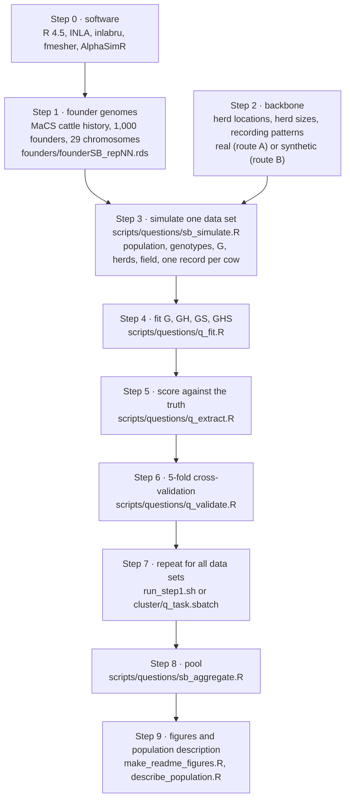

# Reproduce step 1, from the genome to the tables

> **SIMULATED data.** This guide walks through every step of step 1: the founder genomes, the population, the
> genotypes and G, the herds, the spatial field, the records, the model fits, the scoring against the truth, the
> cross-validation, the pooled tables and the figures. Each step lists its script, its seed, the files it writes, and a
> checkpoint.

There are two ways to replicate:

| Route | What you need | What you get |
|---|---|---|
| **A. Exact** | Linux; the software versions of Step 0; the founder files in `founders/` (included); the **real backbone** (not public, see Step 2) | the same data sets, bit for bit, and the numbers of the README |
| **B. Same pipeline** | any machine with R; the founder files (included); the **synthetic backbone** (included) | every step runs exactly as in the paper, on invented herd locations and recording patterns; the numbers are similar in kind, not identical |

**Platform warning for route A:** use Linux and the exact versions of Step 0.
- R-INLA's sampler (`inla.qsample`, used once to draw the true spatial field) gives a different field on Windows than
  on Linux for the same seed.
- A different AlphaSimR version changes the genotypes slightly (Step 3, checkpoint).
- The results were produced on Linux (CentOS Stream 9).

---

## The pipeline at a glance



All commands are run from the repository root. `run_step1.sh` chains Steps 3–8 for any set of data sets.

**Quick start (route B, one data set):**

```bash
Rscript scripts/make_synthetic_backbone.R                        # or skip: synthetic/backbone_synthetic.rds is included
mkdir -p runs/founders data/backbone
cp founders/founderSB_rep*.rds runs/founders/
cp synthetic/backbone_synthetic.rds data/backbone/backbone_tz.rds
CV=no bash run_step1.sh      # 1,000 cows, 70 % single-cow herds, replicate 1: simulate + fit + score, about 25 min
bash run_step1.sh            # adds the 5-fold cross-validation (about 3 h more on a laptop)
```

On a Windows laptop (4 INLA threads), the simulation took 2 min, the four fits 20 min and the cross-validation about
3 h. The synthetic map has a larger mesh than the real one (3,032 nodes against 1,703), so its fits are slower than the
paper's 8 min per 1,000-cow data set.

---

## Step 0. Software

The results were produced with these versions (ilri-hpc; the 4,000-cow data sets on a second node with the same
package versions).

| Software | Version | Install |
|---|---|---|
| R | 4.5.2 | – |
| INLA | 26.08.07 | `install.packages("INLA", repos = c(getOption("repos"), INLA = "https://inla.r-inla-download.org/R/testing"), dep = TRUE)` installs the current testing build; for route A install build 26.08.07 from the same repository |
| inlabru | 2.15.0 | `remotes::install_version("inlabru", "2.15.0")` |
| fmesher | 0.8.0 | `remotes::install_version("fmesher", "0.8.0")` |
| AlphaSimR | 2.1.0.9014 (GitHub gaynorr/AlphaSimR, branch devel, commit a3d58f40cff595001935b835ba58b10be81030e5) | `remotes::install_github("gaynorr/AlphaSimR", ref = "a3d58f40cff595001935b835ba58b10be81030e5")` |
| Matrix | 1.7-4 | with R |
| dqrng | 0.4.1 | `remotes::install_version("dqrng", "0.4.1")` |
| Rcpp, RcppArmadillo, sf | 1.1.1-1.1, 15.2.7-1, 1.1-3 | from CRAN, as dependencies |
| ggplot2, ragg | any recent | only for the figures |

The full record (versions, install sources and `sessionInfo()`) is in [docs/ENVIRONMENT.txt](docs/ENVIRONMENT.txt).

Notes:
- The INLA binary needs a recent Linux (glibc). On older systems, run `INLA::inla.binary.install()` once and choose a
  build for your distribution.
- `scripts/questions/sb_simulate.R` writes the versions it used into `truth/versions.txt` of every data set. For the
  paper's data sets it reads `AlphaSimR 2.1.0.9014 a3d58f40cf | INLA 26.8.7 | fmesher 0.8.0`.

---

## Step 1. The founder genomes

**What:** 1,000 founder genomes per replicate, from a coalescent simulation (MaCS, through AlphaSimR) with AlphaSimR's
cattle history. That history has an effective population size of about 62,000 some 33,000 generations ago, shrinking
to 90 today. There are 29 chromosomes of about 93 Mb and 0.86 Morgan each, with 2,000 segregating sites kept per
chromosome.

**How** (the code in `sb_simulate.R`, Section 4, which runs it when the file is missing):

```r
seed <- 20261001L + 1000L * r                    # r = replicate number, 1-10
set.seed(seed + 206L)
founder <- runMacs(nInd = 1000, nChr = 29, segSites = 2000, species = "CATTLE")
saveRDS(founder, sprintf("runs/founders/founderSB_rep%02d.rds", r))
```

**Files:** the 10 founder files used for the paper are in `founders/` (about 2 MB each); `founders/MD5SUMS.txt` lists
their checksums. Copy them to `runs/founders/`, where the simulator looks for them:

```bash
mkdir -p runs/founders && cp founders/founderSB_rep*.rds runs/founders/
(cd founders && md5sum -c MD5SUMS.txt)
```

**Why the files are included:** AlphaSimR draws the MaCS seeds from R's random-number generator, so the founders follow
from the seed above. But MaCS did not run on our Windows laptop, and a different MaCS build or platform could change
them. With the files, every route starts from the same genomes.

**Regenerating them is possible on Linux:** on 14 November 2026 the code above, run for replicate 1 on the ILRI cluster
(R 4.5.2, AlphaSimR 2.1.0.9014, `nThreads = 1`), wrote a file **bit-identical** to `founders/founderSB_rep01.rds`
(same MD5). It took about 4.7 h at low priority (`nice`) on a busy shared login node, so a free core should be faster.

**Checkpoint:** `md5sum founders/founderSB_rep01.rds` gives `e233474200e9ee760d5d7067833ccb30`.

---

## Step 2. The backbone (herd locations, herd sizes, recording patterns)

The simulator reads `data/backbone/backbone_tz.rds`, an R list with these elements:

| Element | Contents | Used for |
|---|---|---|
| `herds` | `herd`, `region`, `x_km`, `y_km` (km grid), `ward`: one row per farm | herd locations (resampled with a 1 km jitter) and the mesh of the true field |
| `cows` | `animal_id`, `herd`, `dgrp` | sizes of the multi-cow herds |
| `records` | `animal_id`, `herd`, `tyrmn` (test year-month), `cyrsn` (calving year-season), `dgrp`, `lacgr` (lactation group 1–3), `ageZ` (standardised age), `leg1`, `leg2` (Legendre covariates of days in milk), `year`, `Xb_true` (fixed-effect part of the record), `rec_id` | each simulated cow copies the recording pattern of a random template cow |
| `b` | named fixed-effect coefficients | only `dgrp2`–`dgrp4`, to remove the breed part of `Xb_true` |
| `fixed_formula`, `meta` | formula and description | documentation |

- **Route A (real backbone):**
  - Built by our script `scripts/real/00a_build_backbone.R` (not in this repository) from Isidore Houaga's AADGG
    Tanzania data file `milk_yield_pheno_cleaned.csv`, the data of Houaga et al. (2026). The README, Section 10, lists
    what is taken from it.
  - It contains real farm locations, so it is **not in this repository**. Using it needs the permission of Isidore
    Houaga and the data owners.
- **Route B (synthetic backbone):** `scripts/make_synthetic_backbone.R` writes `synthetic/backbone_synthetic.rds`
  (included; seed 20261114). It has the same format, with invented values:
  - 1,386 herds in 156 clustered wards of 4 regions, on a grid of about 620 × 630 km;
  - the herd-size counts of the real data set (997 herds with one cow, 299 with two, …; the paper itself reports only
    1,386 herds, more than 71 % with one cow);
  - 1,894 cows and 19,251 monthly test-days (3–37 per cow, median 9) with lactations, age and lactation curve;
  - invented fixed effects (variance about 0.14).

```bash
mkdir -p data/backbone && cp synthetic/backbone_synthetic.rds data/backbone/backbone_tz.rds
```

---

## Step 3. Simulate one data set (`scripts/questions/sb_simulate.R`)

```bash
Rscript scripts/questions/sb_simulate.R --run runs_q/SB1_one_record/n1000_p70_r01 --rep 1 --ncow 1000 --p1 0.70 --records one --spe 0
```

Arguments: `--ncow` number of cows; `--p1` share of herds with one cow; `--records one` one test-day per cow (step 1);
`--spe 0` no permanent environment (step 1). True values: `--sg 0.06 --sh 0.15 --ss 0.41 --range 33 --se 0.29` (the
defaults). Every random draw has its own seed, `seed = 20261001 + 1000 × replicate` plus an offset, so a replicate gives
the same founders, bulls, cows and field in every cell, and each sub-step can be checked on its own.

| Sub-step | Section of the script | Seed offset | What happens |
|---|---|---|---|
| 3.1 Herd structure | 1 | +202 | number of herds so that a share `p1` has one cow; other herds take sizes from the backbone's multi-cow herds |
| 3.2 Herd locations | 2 | +203 | each herd gets a backbone farm location plus a 1 km jitter (all locations used before any repeats) |
| 3.3 Spatial field | 3 | +4 (INLA sampler), +210 | Matérn field (ν = 1, range 33 km, variance 0.41) drawn on a mesh of the backbone farms; value at each herd; herd effects N(0, 0.15) |
| 3.4 Founders | 4 | +206 | read `runs/founders/founderSB_repNN.rds` (Step 1) |
| 3.5 Genome and trait | 4 | +261 | 200 QTL and 1,500 chip SNPs per chromosome (not overlapping); additive trait; 1,000 founders → 3,000 (random mating) → 10,000 ("the breed today") |
| 3.6 Bulls, dams, cows | 4 | +262 | `ncow/10` bulls and `ncow` dams drawn from the 10,000; each dam gets one daughter by a bull drawn with log-normal popularity |
| 3.7 Breeding values | 4 | – | true breeding values from the QTL, rescaled to variance exactly 0.06 among the cows |
| 3.8 Genotypes and G | 4 | – | cows' chip genotypes; SNPs with MAF ≥ 1 %; VanRaden G; G* = 0.99 G + 0.01 I and its inverse |
| 3.9 Cows to herds | 5 | +263 | cows shuffled into the herd places at random |
| 3.10 Records | 6 | +204, +205, +211 | each cow copies a random template cow's records and keeps one random test-day; residual N(0, 0.29); y = Xb + a + herd + field + e |
| 3.11 Write | 7 | – | analyst files to `data/`, true values to `truth/`, log to `output/00_sim_summary.txt` |

*Columns.* **Sub-step:** one piece of the simulation, in the order it runs. **Section of the script:** the numbered
section of `sb_simulate.R` that does it. **Seed offset:** the number added to the replicate's base seed
(20261001 + 1000 × replicate) before this draw, so each draw can be repeated alone; "–" = no random draw.
**What happens:** what the sub-step does (MAF = minor allele frequency; N(0, v) = normal with mean 0 and variance v).

**Files written:**

| File | Contents |
|---|---|
| `data/herds.csv` | herd, region, ward, x_km, y_km |
| `data/animals.csv` | animal_id, herd, dgrp, sex, role, phenotyped, … (the cows) |
| `data/records.csv` | rec_id, animal_id, herd, tyrmn, cyrsn, lacgr, ageZ, leg1, leg2, year, ygrp, **y** |
| `data/G.rds`, `data/Ginv.rds` | G* of the cows and its inverse |
| `truth/true_animals.csv` | animal_id, **a0_true** (true breeding value), herd, pe_true (0), sire, template_cow, n_records |
| `truth/true_herds.csv` | herd, region, ward, n_cows, **h_true**, **s_true** (field at the herd) |
| `truth/true_bulls.csv` | bull id, true breeding value, n_daughters |
| `truth/true_records.csv` | the parts of each phenotype: Xb_true, a0, pe, h, s, e |
| `truth/true_hyperparameters.csv`, `sim_settings.csv`, `versions.txt`, `field_truth.rds` | true values, settings, software versions, the true field |

The model-fitting scripts read only `data/`; `truth/` is read only when the fits are scored.

**Checkpoint (route A, Linux, replicate 1, 1,000 cows, 70 %):** `output/00_sim_summary.txt` reads

```
-- herds 716 | single-cow herds 500 (69.8 % of herds, 50.0 % of cows) | herd sizes 2/3/4/5+: 167/39/5/5 | real locations reused: no repeats
-- field: truth mesh 1734 nodes (real herds), analyst mesh 1703 nodes | realised var(s) across herds 0.570 | var(h) 0.156
-- one breed: 100 sires (not genotyped) | daughters per sire: median 7, mean 10.3, max 48 | 3 sires unused
-- G: 1000 cows | SNPs 41910 (MAF >= 0.01) | QTL 5800 | diag mean 0.998 | off-diagonal sd 0.0380 | max|G Ginv - I| 5.7e-15
-- records 1000 | per cow: mean 1.0, median 1, range 1-1 | var: Xb 0.154, a 0.060, pe 0.000, y 1.183
```

and the md5 checksums are `truth/true_animals.csv` e987fa62e700ac26713e0a20b04d085a, `truth/true_herds.csv`
f43a7b914e541adb1b1b3c32f4a65760, `data/records.csv` 842194e461ac59f7bf894b7a355772c2.

**Checkpoint (any backbone):** the bulls, dams, matings and G do not depend on the backbone, only on the founders, the
seed and AlphaSimR.
- **Bulls:** on our Windows laptop with the synthetic backbone and AlphaSimR 2.1.0 (CRAN), the "one breed" line was
  identical to the one above (100 sires, median 7, mean 10.3, max 48, 3 unused).
- **G:** it differed slightly (41,909 SNPs, diagonal mean 0.997, off-diagonal sd 0.0382), because the CRAN AlphaSimR
  differs from the development version used for the paper.
- **So for route A install the exact AlphaSimR commit of Step 0.**

---

## Step 4. Fit the four models (`scripts/questions/q_fit.R`)

```bash
Rscript scripts/questions/q_fit.R --run runs_q/SB1_one_record/n1000_p70_r01 --qmodels G,GH,GS,GHS --priors isidore
```

- **Models:** G (animal), GH (+ herd), GS (+ spatial field), GHS (+ herd + field, the true model). Fixed part:
  `tyrmn + cyrsn + ageZ:lacgr + leg1:lacgr + leg2:lacgr`. The mesh is rebuilt from the data set's herds
  (`scripts/sim/_mesh.R`).
- **Priors:**
  - `--priors isidore` = INLA's default on every variance, as in Houaga et al.'s script;
  - `--priors pc` = PC priors, P(σ > 0.5) = 0.5 on animal and herd, P(σ > 1) = 0.5 on the residual.
  - The field has the PC-Matérn prior P(σ > 0.5) = 0.5, P(range < 50 km) = 0.8 in both.
- **Integration:** empirical Bayes. **Output:** `output/q_fit_summaries.rds` (variances, EBVs, herd and field effects,
  WAIC), `output/q_fit_log.txt`.
- **Time:** about 8 min (1,000 cows), 46 min (2,000), 4 h (4,000) with 5 threads.

## Step 5. Score against the truth (`scripts/questions/q_extract.R`)

```bash
Rscript scripts/questions/q_extract.R --run runs_q/SB1_one_record/n1000_p70_r01
```

Writes `output/q_vars.csv` (each variance with its 95 % interval and the truth) and `output/q_metrics.csv` (accuracy
r(EBV, a), slope of a on EBV, WAIC, marginal likelihood, minutes).

**Checkpoint (route A, Linux, n1000_p70_r01, INLA's default prior):**

| Model | σ̂²g | σ̂²h | σ̂²s | Range km | σ̂²e | r(EBV, a) | WAIC |
|---|---|---|---|---|---|---|---|
| G | 0.0532 | – | – | – | 1.008 | 0.308 | 2,957.0 |
| GH | 0.00013 (collapsed) | 0.793 | – | – | 0.286 | 0.279 | 2,132.1 |
| GS | 0.0298 | – | 0.484 | 53.3 | 0.486 | 0.404 | 2,272.2 |
| GHS | ≈ 0 (collapsed) | 0.226 | 0.496 | 59.3 | 0.312 | 0.372 | 1,975.9 |

*Columns.* The values your run should reproduce for this one data set. **σ̂²g:** estimated genetic variance (truth
0.060). **σ̂²h:** herd variance (truth 0.150). **σ̂²s:** spatial-field variance (truth 0.41). **Range km:** distance at
which farms' environments become almost unrelated (truth 33). **σ̂²e:** residual variance (truth 0.290). **r(EBV, a):**
accuracy, the correlation of estimated with true breeding values. **WAIC:** prediction score of the fit, lower is
better. "–" = the model has no such term; "collapsed" = σ̂²g at the bottom of the prior.

(This data set is one of the step-1 collapses; with `--priors pc` GHS gives about 0.045.)

## Step 6. Cross-validation (`scripts/questions/q_validate.R`)

```bash
Rscript scripts/questions/q_validate.R --run runs_q/SB1_one_record/n1000_p70_r01 --cv kfold --qmodels G,GH,GS,GHS --priors isidore
```

- The cows are split into 5 folds with seed `20261101 + replicate`. Each fold's records are hidden in turn and
  predicted from a fit to the other four folds.
- The predictions use 200 posterior samples (seed 1).
- Writes `output/q_validate_kfold.csv`: for each model and for all, seen-herd and unseen-herd cows, it gives masked
  r(EBV, a), cor(y, ŷ) with its genetic and environmental parts, and training-cow r(EBV, a).
  - **Masked cows:** the cows of the hidden fold. **Training cows:** the cows of the other four folds.
  - **Seen-herd cows:** masked cows with at least one herd-mate among the training cows (the model knows that herd's
    effect). **Unseen-herd cows:** masked cows with no herd-mate among the training cows (every single-cow herd, or a
    small herd masked together), so the model has never seen a record from that farm.
  - **Masked r(EBV, a):** correlation between a masked cow's EBV (from relatives only) and her true breeding value.
    **cor(y, ŷ):** correlation between the hidden record and its prediction.
- Run in replicates 1–5 only (as in the paper). About 45 min (1,000 cows) or 4 h (2,000 cows).

## Step 7. All data sets

| Set | Data sets | Command |
|---|---|---|
| Step 1, INLA's default prior | 80 (1,000 and 2,000 cows × 50/60/70/80 % × replicates 1–10; CV in replicates 1–5) | one machine: `CELLS="n1000_p50 n1000_p60 n1000_p70 n1000_p80 n2000_p50 n2000_p60 n2000_p70 n2000_p80" REPS="$(seq 1 10)" bash run_step1.sh`; Slurm: see `cluster/q_task.sbatch` |
| Step 1, 4,000 cows | 5 (70 %, replicates 1–5, no CV) | `CELLS="n4000_p70" REPS="$(seq 1 5)" CV=no bash run_step1.sh` |
| PC-prior refit | the same 80 data sets, refitted (not re-simulated) | `STUDY=SB1_pc PRIORS=pc CV=no CELLS="…" REPS="$(seq 1 10)" bash run_step1.sh` |

`run_step1.sh` skips finished steps, so it can be stopped and restarted. On a cluster, `cluster/q_task.sbatch` runs one
data set per array task (commands in its header).

## Step 8. Pool (`scripts/questions/sb_aggregate.R`)

```bash
Rscript scripts/questions/sb_aggregate.R --question SB1_one_record      # -> output/questions/SB1_one_record/
Rscript scripts/questions/sb_aggregate.R --question SB1_pc              # -> output/questions/SB1_pc/
```

Writes `report.md`, `sb_summary.csv` (per cell × model), `sb_by_rep.csv` (per data set × model) and `sb_cv_by_rep.csv`
(cross-validation). On route A these equal `results/step1_default_prior/` and `results/step1_pc_prior/`.

## Step 9. Figures and population description

```bash
Rscript scripts/make_readme_figures.R          # reads results/; copy your own output/questions/... there to redraw
Rscript scripts/describe_population.R          # needs all step-1 data sets, including n1000/n2000/n4000_p70 of replicates 1-3
```

`describe_population.R` also rebuilds the full pedigree of replicates 1–3 from the founders and checks it against the
saved truth (`B_pedigree.csv`: `check_same_sires` must be TRUE, `check_max_diff_a` below 1e-12). Its tables are in
`results/population/` and are described in [docs/POPULATION.md](docs/POPULATION.md).

---

## All seeds in one place

| Where | Seed |
|---|---|
| Replicate base seed | 20261001 + 1000 × replicate |
| Herd structure, locations, field, herd effects | base + 202, + 203, + 4 (INLA sampler), + 210 |
| Founders (only when the founder file is missing) | base + 206 |
| Genome, trait, chip, random mating | base + 261 |
| Bulls, dams, matings | base + 262 |
| Cows to herds; record templates; one record; residuals | base + 263; + 204; + 205; + 211 |
| Cross-validation folds | 20261101 + replicate |
| Posterior samples in cross-validation | 1 |
| Synthetic backbone | 20261114 |

---

## What has been checked (14 November 2026)

| Check | Result |
|---|---|
| Founder files in `founders/` equal the files used on the cluster | yes: all 10 MD5 sums match |
| The pedigree rebuilt from the founders and seeds equals the saved data (`describe_population.R`, Part B) | yes, on Linux: the same bull for every cow and the same true breeding values (difference < 3e-15) in all 9 checks |
| Route B end to end on a Windows laptop (R 4.5.1, INLA 26.6.7, AlphaSimR 2.1.0 from CRAN; synthetic backbone; n1000_p70_r01) | simulation, fits and scoring ran with `run_step1.sh`; bulls and daughters identical to the paper's data set; G slightly different (AlphaSimR version); GHS had the best WAIC (1,901 against GH 2,033, GS 2,234, G 2,686); GS estimated the range at 32 km (truth 33) |
| Cross-validation in the same laptop run | yes: all 5 folds and the pooling ran (3.0 h; GHS folds 16–34 min). Masked r(EBV, a): G 0.254, GH 0.284, GS 0.317, GHS 0.332; training cows 0.388 / 0.418 / 0.448 / 0.451; cor(y, ŷ) 0.268 / 0.446 / 0.573 / 0.598. Same pattern as the README table (G < GH < GS ≈ GHS; masked cows well below training cows); one data set on a different map, so the values are not expected to equal the 1,000-cow means |
| Founders regenerated from the seed with `runMacs` on Linux equal the supplied files | yes, for replicate 1: the regenerated file has the same MD5 (e233474200e9ee760d5d7067833ccb30), so the founders are bit-identical (ILRI cluster, R 4.5.2, AlphaSimR 2.1.0.9014) |
