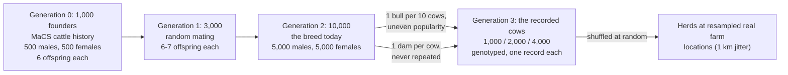

# The simulated population: generations, families, herds and space

[README](../README.md) &nbsp;·&nbsp; [Reproduce](../REPRODUCE.md) &nbsp;·&nbsp; **The population** &nbsp;·&nbsp; [Plan for steps 2–3](../PLAN_STEPS_2_3.md)

> [!IMPORTANT]
> **SIMULATED data.** This page describes the population behind the step-1 results in the [README](../README.md):
> who the cows are, how they are related, how they sit in herds and on the map. It gives distances and counts only,
> never coordinates.

**Where the numbers come from:**
- **All 85 step-1 data sets:** herds, bulls, daughters, half-sisters, distances, G and the true field.
- **The full pedigree** (founders → generation 1 → generation 2 → cows) of replicates 1–3, rebuilt with the
  simulator's own seeds. The rebuilt pedigree gives every cow the same bull as the saved data, and the same true
  breeding value to within 3 × 10⁻¹⁵, in all 9 checks (3 replicates × 1,000, 2,000 and 4,000 cows).
- Script [`scripts/describe_population.R`](../scripts/describe_population.R); tables in
  [`results/population/`](../results/population/).

Steps 2 and 3 of the study use the same cows, bulls, herds and field (same seeds), so this page describes them too.

**In short**
- **Four generations:** 1,000 founders → 3,000 → 10,000 ("the breed today") → the recorded cows. Bulls and dams both
  come from the 10,000.
- **One bull per 10 cows, used very unevenly:**
  - the median bull has 6–7 daughters and the busiest 44–199;
  - about 6 % of the bulls drawn have no daughter.
- **Every dam has exactly one daughter,** so the cows have no full sisters and no maternal half-sisters. Their close
  relatives are **paternal half-sisters**: 22–27 per cow on average (median 17). 92–94 % of cow pairs are unrelated in
  the pedigree.
- **Relatives are scattered at random over the map:**
  - a cow has about 1.2–1.5 half-sisters within 10 km;
  - fewer than 3 % of cows have one in their own herd;
  - relatedness is the same next door as 100 km away.
- **Farms cluster and neighbours share the environment:**
  - a cow has 50–215 other cows within 10 km;
  - the true field is correlated about 0.7–0.85 between herds less than 10 km apart.

## 1. Generations

- **Founders** come from a coalescent simulation (MaCS) with AlphaSimR's cattle history: effective size about 62,000
  some 33,000 generations ago, falling to 90 today. They are unrelated in the pedigree but share that history, which
  creates the linkage disequilibrium between SNPs and QTL.
- **Generations 1 and 2** are large and mate at random, with parents used evenly, so little new relationship or
  inbreeding builds up.
- **Bulls and dams are not genotyped and have no records,** as in the real data. Only the cows are in G.

## 2. Genome and trait

| Piece | Setting |
|---|---|
| Chromosomes | 29, each about 93 Mb and 0.86 Morgan (25 Morgans in total) |
| QTL | 5,800 (200 per chromosome), not on the chip; purely additive, normal effects |
| SNP chip | 43,500; 41,800–42,100 after removing minor allele frequency < 1 % in the cows |
| Genetic variance | true breeding values rescaled to variance exactly 0.060 in every data set |
| G | VanRaden G from the cows' allele frequencies; G* = 0.99 G + 0.01 I |

*Columns.* **Piece:** one part of the simulated genome or trait. **Setting:** its value (Mb = million base pairs;
Morgan = genetic map length, 1 Morgan ≈ one crossover per meiosis; QTL = the DNA positions that truly affect milk
yield; SNP chip = the markers used to build G; G = the genomic relationship matrix between cows).

## 3. Bulls and dams

The bulls do not depend on the share of single-cow herds: the four herd structures of a replicate share them. Mean over
replicates; range in brackets.

| | 1,000 cows | 2,000 cows | 4,000 cows |
|---|---|---|---|
| Bulls drawn (target: 1 per 10 cows) | 100 | 200 | 400 |
| Bulls with at least one daughter | 94 (89–98) | 189 (187–192) | 377 (371–380) |
| Daughters per used bull: mean / median | 10.7 / 7 | 10.6 / 7 | 10.6 / 6 |
| Daughters of the busiest bull | 63 (44–90) | 92 (47–199) | 120 (109–147) |
| Cows sired by the 10 busiest bulls | 38 % | 24 % | 18 % |
| Cows that are their bull's only daughter | 0.7 % | 0.8 % | 0.8 % |
| Bull pairs that are half-brothers (replicates 1–3) | 1–10 of 4,950 | 25–37 of 19,900 | 106–131 of 79,800 |

*Columns.* First column: the quantity. **1,000 / 2,000 / 4,000 cows:** its value in data sets of that size, mean over
replicates with the range over replicates in brackets. Rows: **Bulls drawn:** bulls sampled as possible sires.
**Bulls with at least one daughter:** bulls that actually sired a recorded cow. **Daughters per used bull:** among those
bulls. **Daughters of the busiest bull:** the largest family. **Cows sired by the 10 busiest bulls:** the share of all
cows. **Cows that are their bull's only daughter:** cows with no paternal half-sister. **Bull pairs that are
half-brothers:** pairs of used bulls with the same father, out of all bull pairs.

**Share of cows by their bull's number of daughters**

| Daughters per bull | 1 | 2–4 | 5–9 | 10–19 | 20–49 | 50+ |
|---|---|---|---|---|---|---|
| 1,000 cows | 0.7 % | 7.6 % | 18.1 % | 27.3 % | 37.5 % | 8.8 % |
| 2,000 cows | 0.8 % | 7.4 % | 18.7 % | 28.5 % | 33.3 % | 11.4 % |
| 4,000 cows | 0.8 % | 8.0 % | 17.6 % | 27.4 % | 28.5 % | 17.7 % |

*Columns.* **1 … 50+:** classes of family size, i.e. how many recorded daughters the cow's bull has (her own family
included). *Each cell:* the share of cows whose bull falls in that class; each row adds up to 100 %.

**Dams:**
- They are drawn without repetition from the 5,000 females of generation 2, and **each has exactly one daughter**.
- Pairs of dams that are half-sisters are about 0.16 % of all dam pairs; no two dams are full sisters.
- Cow inbreeding is almost nil: mean F 0.0004–0.001, and 1.2–2.4 % of cows have related parents.

## 4. Relatives of a cow

Pedigree class of every pair of cows; replicates 1 / 2 / 3. Mean G is not available at 4,000 cows (G was not kept).

| Class | Pedigree relationship | 1,000 cows: per cow | mean G | 2,000 cows: per cow | mean G | 4,000 cows: per cow |
|---|---|---|---|---|---|---|
| Half-sisters or closer | ≥ 1/4 | 17.8 / 23.1 / 21.3 | 0.24 | 25.2 / 21.3 / 23.4 | 0.24 | 25.2 / 33.5 / 28.4 |
| Cousin level | 1/16 to < 1/4 | 4.7 / 2.6 / 3.6 | 0.05–0.06 | 9.0 / 9.6 / 7.1 | 0.06 | 18.4 / 15.7 / 17.2 |
| Second-cousin level | 1/64 to < 1/16 | 47 / 47 / 52 | 0.01 | 104 / 101 / 100 | 0.01 | 203 / 218 / 210 |
| Unrelated in the pedigree | 0 | 929 / 926 / 922 | −0.007 | 1,861 / 1,867 / 1,868 | −0.004 | 3,752 / 3,732 / 3,744 |

*Columns.* **Class:** a kind of relative. **Pedigree relationship:** the additive relationship from the pedigree that
defines the class (1/4 = paternal half-sisters). **per cow:** how many other cows of that class each cow has, on
average, in replicates 1 / 2 / 3. **mean G:** the average genomic relationship of such pairs, measured from the SNPs
(it can differ from the pedigree value because of Mendelian sampling and allele frequencies).

- **Half-sisters share 0.24 on average in G, but anything from about 0.10 to 0.40** (Mendelian sampling, which G sees
  and the pedigree cannot). Almost every pair with G above 0.1 is a pair of half-sisters.
- The correlation of G with the pedigree relationship over all pairs is 0.87–0.88 (1,000 cows) and 0.82–0.83 (2,000).
- **So a cow's genetic information comes almost entirely from her bull's other daughters.** Two half-sisters share
  0.25 × 0.06 = 0.015 of variance, a small signal in records with total variance about 0.9. That is why one record per
  cow says little about σ²g.

## 5. Herds

The number of herds is set so that the target share has one cow. The other herds take sizes from the real multi-cow
herds of the AADGG Tanzania data set of Houaga et al. (2026). **Cows are shuffled into herds at random.** Mean over
replicates.

| Cows | Single-cow herds: target / realised | Herds | Cows in single-cow herds | Herds with 2 / 3 / 4 / 5+ cows | Herd-mate pairs | … that are half-sisters |
|---|---|---|---|---|---|---|
| 1,000 | 50 % / 49.6 % | 600 | 29.8 % | 229 / 57 / 10 / 6 | 546 | 2.4 % |
| 1,000 | 60 % / 59.5 % | 649 | 38.6 % | 199 / 50 / 9 / 6 | 484 | 2.2 % |
| 1,000 | 70 % / 69.7 % | 713 | 49.7 % | 164 / 41 / 7 / 4 | 392 | 2.4 % |
| 1,000 | 80 % / 79.8 % | 788 | 62.9 % | 121 / 29 / 5 / 3 | 292 | 2.2 % |
| 2,000 | 50 % / 50.0 % | 1,210 | 30.2 % | 465 / 110 / 21 / 9 | 1,052 | 1.1 % |
| 2,000 | 60 % / 60.0 % | 1,312 | 39.4 % | 403 / 96 / 18 / 9 | 921 | 1.1 % |
| 2,000 | 70 % / 70.0 % | 1,436 | 50.2 % | 331 / 79 / 14 / 7 | 758 | 1.3 % |
| 2,000 | 80 % / 79.9 % | 1,581 | 63.2 % | 241 / 60 / 10 / 6 | 569 | 1.3 % |
| 4,000 | 70 % / 70.0 % | 2,874 | 50.3 % | 663 / 158 / 27 / 14 | 1,502 | 0.8 % |

*Columns.* **Cows:** cows per data set. **Single-cow herds: target / realised:** the share of herds with exactly one
cow, as designed and as obtained. **Herds:** number of herds. **Cows in single-cow herds:** the share of cows that
are alone in their herd. **Herds with 2 / 3 / 4 / 5+ cows:** how many herds of each larger size. **Herd-mate pairs:**
pairs of cows in the same herd (the only pairs that tell the model about the herd effect). **… that are half-sisters:**
the share of those herd-mate pairs that also share a father.

Herd-mates are related exactly as often as any two cows (half-sister pairs are 2.2 %, 1.2 % and 0.7 % of all pairs at
1,000, 2,000 and 4,000 cows). The herd variance has to be learned from these few hundred herd-mate pairs.

## 6. The map and the spatial field

The herds sit at the farm locations of the AADGG Tanzania data set of Houaga et al. (2026). Each location is projected
to km and moved by a random 1 km jitter; farms are reused when a data set has more herds than the 1,386 real farms. So
this section describes the real farm layout, given only as distances and counts.

- **Area:** about 710 × 710 km in 4 regions.
- **Farm clusters:** farms sit in clusters, so the median distance from a herd to the nearest other herd is 0.4–1.0 km.
- **Distances between cows:** about 5 % of cow pairs are within 10 km, 6 % at 10–33 km, 15 % at 33–100 km and 73 % more
  than 100 km apart.

| Cows | Single-cow herds | Herds within 10 km (median) | Cows within 10 km (mean) | Cows within 33 km (mean) |
|---|---|---|---|---|
| 1,000 | 50 / 60 / 70 / 80 % | 20 / 21 / 23 / 26 | 54 / 53 / 53 / 54 | 115 / 115 / 115 / 116 |
| 2,000 | 50 / 60 / 70 / 80 % | 39 / 43 / 47 / 51 | 106 / 106 / 105 / 106 | 231 / 231 / 230 / 231 |
| 4,000 | 70 % | 93 | 214 | 463 |

*Columns.* **Single-cow herds:** the design's share of herds with one cow; the next three columns give one value per
share, in the same order. **Herds within 10 km (median):** for each herd, how many other herds lie within 10 km; the
median over herds. **Cows within 10 km / 33 km (mean):** for each cow, how many other cows live within that distance
(33 km is the field's range); the mean over cows.

**Correlation of the true field between two herds, by distance** (Matérn ν = 1, range 33 km; pooled over the 85 data
sets)

| Distance | 0–5 km | 5–10 km | 10–20 km | 20–33 km | 33–66 km | 66–100 km | 100–200 km | 200+ km |
|---|---|---|---|---|---|---|---|---|
| Matérn, middle of the class | 0.95 | 0.76 | 0.49 | 0.22 | 0.04 | 0.00 | 0.00 | 0.00 |
| Realised | 0.85 | 0.69 | 0.46 | 0.21 | −0.12 | −0.17 | −0.17 | −0.05 |

*Columns.* **0–5 km … 200+ km:** classes of distance between two herds. Rows: **Matérn, middle of the class:** the
correlation the field model gives at the middle distance of the class (the theory). **Realised:** the correlation of
the true simulated field values between all pairs of herds in that class, pooled over the data sets.

The realised correlations beyond 33 km are slightly negative. That is expected when one field per replicate is measured
around its own mean over a large area. A herd with no records has 20–90 herds within 10 km whose environment is
correlated about 0.7 with its own: this is what lets GS and GHS predict **unseen herds** (in cross-validation: herds
with no cow at all in the training data, so the model has never seen a record from that farm).

## 7. Families on the map: how many half-sisters live close by

| Cows | Single-cow herds | Half-sisters per cow | Cows with a half-sister in their herd | Half-sisters within 10 km (mean) | Cows with ≥ 1 within 10 km | Half-sisters within 33 km (mean) | Cows with ≥ 1 within 33 km |
|---|---|---|---|---|---|---|---|
| 1,000 | 50 % | 22.0 | 2.6 % | 1.19 | 48 % | 2.53 | 72 % |
| 1,000 | 60 % | 22.0 | 2.0 % | 1.21 | 48 % | 2.59 | 73 % |
| 1,000 | 70 % | 22.0 | 1.9 % | 1.16 | 48 % | 2.56 | 73 % |
| 1,000 | 80 % | 22.0 | 1.3 % | 1.25 | 49 % | 2.59 | 72 % |
| 2,000 | 50 % | 24.2 | 1.2 % | 1.29 | 48 % | 2.82 | 72 % |
| 2,000 | 60 % | 24.2 | 1.0 % | 1.32 | 48 % | 2.84 | 72 % |
| 2,000 | 70 % | 24.2 | 0.9 % | 1.29 | 47 % | 2.79 | 72 % |
| 2,000 | 80 % | 24.2 | 0.7 % | 1.28 | 48 % | 2.82 | 72 % |
| 4,000 | 70 % | 27.4 | 0.6 % | 1.47 | 50 % | 3.18 | 73 % |

*Columns.* **Single-cow herds:** the design's share of herds with one cow. **Half-sisters per cow:** recorded cows with
the same father, mean per cow. **Cows with a half-sister in their herd:** share of cows that have a paternal
half-sister as a herd-mate. **Half-sisters within 10 km / 33 km (mean):** how many of a cow's half-sisters live within
that distance of her farm. **Cows with ≥ 1 within 10 km / 33 km:** share of cows that have at least one half-sister
that close.

**Share of cow pairs that are half-sisters, by distance** (equal in every column if relatives are placed at random)

| Cows | Same herd | 0–10 km | 10–33 km | 33–100 km | 100+ km |
|---|---|---|---|---|---|
| 1,000 | 2.29 % | 2.25 % | 2.21 % | 2.21 % | 2.20 % |
| 2,000 | 1.18 % | 1.23 % | 1.22 % | 1.21 % | 1.21 % |
| 4,000 | 0.80 % | 0.69 % | 0.69 % | 0.69 % | 0.69 % |

*Columns.* **Same herd:** pairs of cows in the same herd. **0–10 km … 100+ km:** pairs of cows in different herds at
that distance. *Each cell:* the share of those pairs that are paternal half-sisters. If relatives were clustered in
space, the left-hand columns would be higher.

**There is no spatial genetic structure:** half-sisters are spread over distances exactly like any two cows, and mean G
is the same at every distance. A field and a genetic effect are told apart by who shares them (neighbours against
relatives); here those two groups are independent. This is the easy case. Real data with regional bulls, or daughters
staying near their dams, would cluster relatives in space and could mix the two.

## 8. What this means for the results

| Feature of the population | Consequence in the step-1 results |
|---|---|
| Relatives are almost only paternal half-sisters (22–27 per cow), sharing 1/4 | With one record per cow the genetic signal is small; σ̂²g is imprecise and the prior can decide it |
| Bull use is very uneven (median 6–7 daughters, up to 199) | A cow without records is predicted mainly from her bull's other daughters (accuracy 0.25–0.32) |
| More cows bring more half-sisters per cow and more large families | Accuracy rises with the number of cows; σ̂²g is right at 4,000 cows |
| Herd-mates are few and unrelated | The herd variance rests on a few hundred pairs; in a single-cow herd the herd effect cannot be split from the cow's own record |
| Neighbours are many and share the field strongly | The field is well estimated and predicts herds the model has never seen |
| Relatives are scattered at random | No model puts environment into genetics; regional bulls in real data could change this |
| The bulls are the same for every share of single-cow herds | Differences between herd-structure cells come from the herds alone |

*Columns.* **Feature of the population:** a fact from the sections above. **Consequence in the step-1 results:** what
it does to the estimates in the [README](../README.md).
